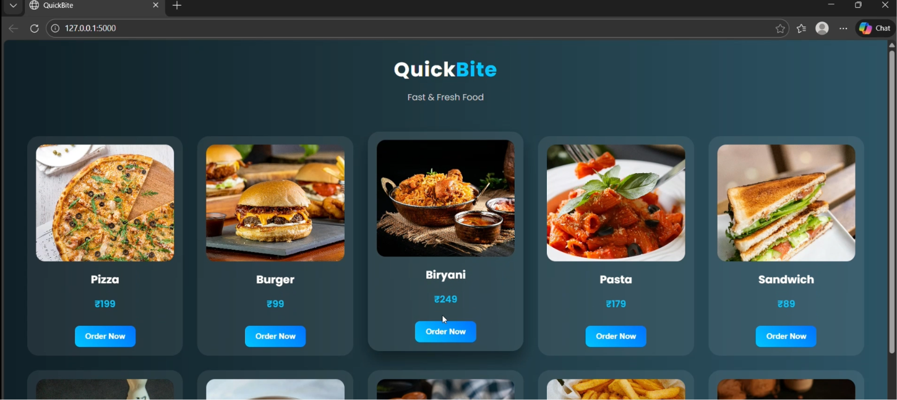

#  QuickBite – Food Delivery Web Application

## Home Page



QuickBite is a modern Food Delivery Web Application built using **Python, Flask, HTML, CSS, SQLite, and Jinja2**.

The application allows users to browse available food items, enter delivery details, choose a payment method, and place orders. Food items and customer orders are managed using an SQLite database.

## ✨ Features

- Browse available food items
- Dynamic food listing from the database
- Delivery details form
- Payment method selection
- Place food orders
- Store orders using SQLite
- Modern dark-themed user interface
- Responsive web design

## 🛠️ Technologies Used

- **Python** – Backend programming
- **Flask** – Web application framework
- **HTML5** – Web page structure
- **CSS3** – Styling and responsive design
- **SQLite** – Database management
- **Jinja2** – Dynamic HTML templating

## 🧪 QA Testing

QA testing tools have been added to the project to support application testing and improve software quality.

- **Pytest** – Automated test execution
- **Playwright** – Browser automation testing
- **Postman** – API request testing

### Run Automated Tests

Run the following command from the project root directory:

```bash
python -m pytest qa/tests/test_quickbite.py -v
```

Pytest displays the test results in the terminal.

### Browser Automation

Playwright can be used to automate browser interactions and validate supported application workflows.

### API Testing

Postman can be used to send API requests and verify the application's responses using the configured collection.

*Note: Actual test coverage and results depend on the implemented test cases and successful test execution.*

## ⚙️ Installation and Setup

### 1. Clone the Repository

```bash
git clone https://github.com/Damayanthi03/food-delivery.git
cd food-delivery
```

### 2. Create a Virtual Environment

```bash
python -m venv .venv
```

Activate the environment in Windows PowerShell:

```powershell
.venv\Scripts\Activate.ps1
```

### 3. Install Dependencies

```bash
pip install flask pytest playwright
```

Install the Playwright browser binaries if browser tests require them:

```bash
python -m playwright install
```

Install any other dependencies required by the application or test suite.

### 4. Initialize the Database

```bash
python db.py
```

### 5. Run the Application

```bash
python app.py
```

Open the local URL displayed in the terminal, usually:

`http://127.0.0.1:5000/`

## 🔄 Application Workflow

1. Browse the available food items.
2. Select food and provide delivery details.
3. Choose a payment method.
4. Place the order.
5. Store order information in the SQLite database.

## 🚀 Future Improvements

- User authentication
- Shopping cart enhancements
- Order status tracking
- Online payment gateway integration
- Expanded automated testing
- Application deployment

## 👩‍💻 Project

**QuickBite – Food Delivery Web Application**

Built with Python, Flask, SQLite, HTML, CSS, and Jinja2, with QA testing tools including Pytest, Playwright, and Postman.
